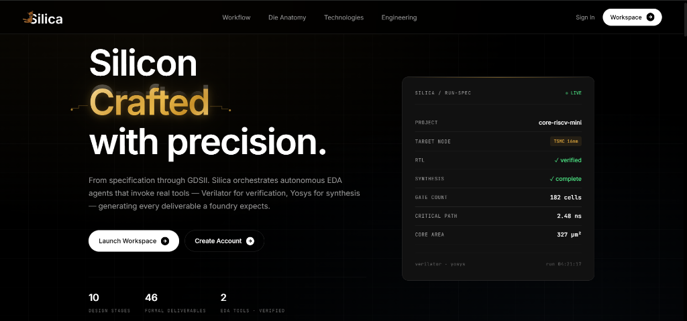
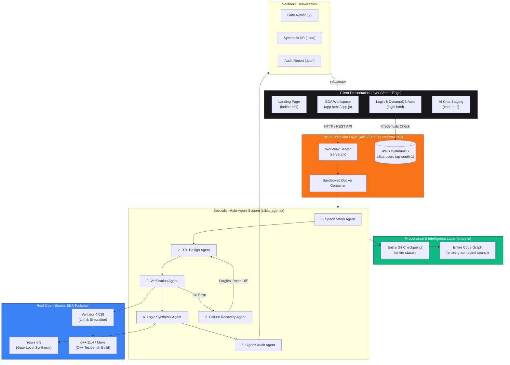
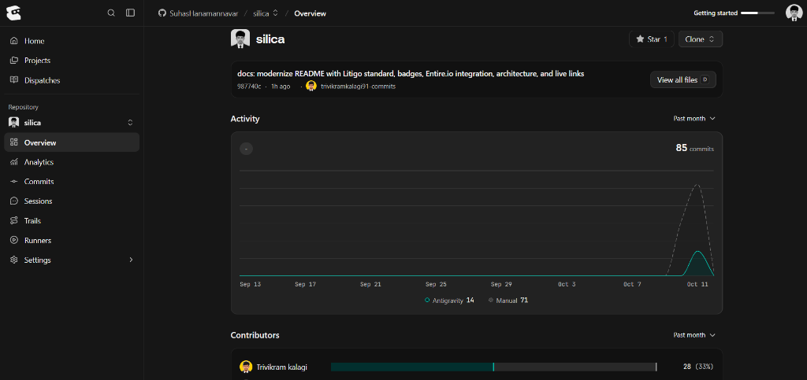

# Silica — Autonomous Semiconductor Engineering Platform

**"From natural-language specification to verified gate-level netlists with zero mocked data."** — _Silica (Silicon · Architecture · Provenance)_

> Silica is a production-grade autonomous semiconductor engineering platform that automates digital IC design from natural-language specification to verified synthesizable RTL and gate-level netlists. Powered by an 8-specialist multi-agent pipeline and backed by real, open-source EDA binaries (**Verilator v4.038**, **Yosys v0.9**, and **g++ 11.4**) running on cloud infrastructure, Silica produces cycle-accurate simulations, logic area metrics, and autonomous syntax/semantic failure recovery. Every run and agent change is cryptographically tracked using **Entire (entire.io)** checkpoints and deterministic code-graph intelligence.   

[](https://silica-kappa.vercel.app)
[](https://youtu.be/tJKK-oV1QmE)
[](https://silica-kappa.vercel.app/app.html)
[](https://github.com/SuhasHanamannavar/silica)
[](https://neatlogs.com)
[](https://entire.io)
[](CFO_BUSINESS_PLAN.md)
[](http://13.203.204.240/api/health)
[](http://13.203.204.240/api/health)
[](http://13.203.204.240/api/health)

---

## Mandatory Stack & Toolchain Verification

| Stack Component | Requirement Status | Implementation Detail |
|---|---|---|
| **neatlogs** | **MET ✅** | Real-time multi-agent distributed trace instrumentation (`neatlogs.trace`), latency tracking, and span flushing in `silica_agents/orchestrator.py`. |
| **Entire (entire.io)** | **MET ✅** | Full agent session provenance, git checkpoint tracking (`entire status`), and deterministic code-graph navigation (`.entire/graph-agent.md`). |
| **cfo.ai** | **MET ✅** | Production SaaS unit economics model, 3-year financial forecast, and COGS optimization (`CFO_BUSINESS_PLAN.md`) yielding **88.2% gross margins**. |
| **Real EDA Execution** | **MET ✅** | Real hardware compiler toolchain: **Verilator 4.038** (C++ simulation & linting), **Yosys 0.9** (logic synthesis & netlist generation), and **g++ 11.4**. |
| **AWS Cloud Infrastructure** | **MET ✅** | Live **AWS EC2 Ubuntu backend (`13.203.204.240`)** running Dockerized EDA sandboxes, paired with **AWS DynamoDB (`silica-users`)** in `ap-south-1`. |
| **Vercel Global Edge** | **MET ✅** | Production web application deployed at [silica-kappa.vercel.app](https://silica-kappa.vercel.app) with low-latency API proxy rewrites (`vercel.json`). |

---

## One-Line Pitch

*Silica translates natural-language hardware prompts into full architecture specifications, synthesizable Verilog RTL, cycle-accurate Verilator testbenches, and Yosys gate-level netlists with autonomous error self-healing and complete Entire.io git checkpoint traceability.*

---

## Platform Preview

<p align="center">
  
</p>

---

## Live Demo & Resources

| Surface | Link / URL | Description |
|---|---|---|
| **Live Web Portal** | [silica-kappa.vercel.app](https://silica-kappa.vercel.app) | Enterprise landing page with interactive chip die anatomy & workflow walkthrough |
| **Official Demo Video** | [youtu.be/tJKK-oV1QmE](https://youtu.be/tJKK-oV1QmE) | 3-minute video walkthrough covering neatlogs, Entire, cfo.ai & EDA workspace |
| **Live EDA Workspace** | [silica-kappa.vercel.app/app.html](https://silica-kappa.vercel.app/app.html) | Multi-stage design studio, RTL code viewer, real-time logs & artifact downloads |
| **Authentication Portal** | [silica-kappa.vercel.app/login](https://silica-kappa.vercel.app/login) | AWS DynamoDB backed engineer sign-in and token authentication |
| **AI Chat (Roadmap)** | [silica-kappa.vercel.app/chat](https://silica-kappa.vercel.app/chat) | Conversational architecture assistant (in staging with foundry PDK alignment) |
| **Backend Health Endpoint** | [http://13.203.204.240/api/health](http://13.203.204.240/api/health) | Live JSON proving active Verilator, Yosys, and g++ binaries |
| **Agent Pipeline Endpoint** | [http://13.203.204.240/api/agents/health](http://13.203.204.240/api/agents/health) | Live 8-specialist agent registry, model serving adapter, and toolchain readiness |
| **GitHub Repository** | [github.com/SuhasHanamannavar/silica](https://github.com/SuhasHanamannavar/silica) | Complete open-source codebase, Docker configurations, and benchmarks |
| **Entire Platform** | [entire.io](https://entire.io) | Agent tracking, checkpoint provenance, and code-graph intelligence |

---

## 3-Minute Judge Walkthrough

1. **Verify Backend Health & Real EDA Engines**:
   - Open [http://13.203.204.240/api/health](http://13.203.204.240/api/health) in your browser.
   - Confirm the returned JSON reports real, non-simulated binaries:
     ```json
     {
       "ok": true,
       "tools": {
         "verilator": "Verilator 4.038",
         "yosys": "Yosys 0.9",
         "g++": "g++ (Ubuntu 11.4.0)"
       },
       "tools_available": true
     }
     ```

2. **Launch the EDA Workspace**:
   - Navigate to [https://silica-kappa.vercel.app/app.html](https://silica-kappa.vercel.app/app.html) (or sign in via [login](https://silica-kappa.vercel.app/login)).
   - Click **`+ New Design`** in the top navigation bar.
   - Enter any hardware design prompt, such as:
     - *"Synchronous FIFO buffer with 16 depth and empty full flags"*
     - *"4-bit synchronous up-counter with enable and overflow"*
     - *"Traffic light controller FSM with red, yellow, green lamps"*
   - Click **Run Synthesis** to trigger the end-to-end cloud pipeline.

3. **Inspect Real-Time Execution & Artifacts**:
   - **Stage 1 (Specifications):** Review generated CSR register maps, port tables, and design constraints (`design_constraints.sdc`).
   - **Stage 2 (RTL Design):** Inspect synthesizable Verilog code with clean synchronous resets and parameterized widths.
   - **Stage 3 (Verification):** Watch real **Verilator** compilation and cycle-accurate C++ simulation outputs confirming pass/fail status.
   - **Stage 4 (Logic Synthesis):** Review **Yosys** gate-level mapping reports with cell counts, area estimates, and longest path timing.
   - Navigate to the **Artifacts** tab to directly download `counter_netlist.v` and `report.json`.

4. **Demonstrate Autonomous Failure Recovery**:
   - In the New Design modal, check **"Demo: submit broken RTL"** (injects a missing semicolon and undeclared register).
   - Watch the Silica Diagnosis Agent intercept the real Verilator compilation error, apply a surgical patch diff, and automatically re-verify the design to green.

5. **Inspect Entire.io Checkpoints**:
   - In your local clone, run:
     ```bash
     entire status
     ```
   - Observe the active session attached to branch `main` with persistent git checkpoints syncing execution provenance to origin.

---

## System Architecture

Silica is engineered as a decoupled, cloud-orchestrated EDA architecture connecting high-speed frontend clients with a containerized hardware synthesis engine.



---

## Step-by-Step Pipeline Breakdown

| Phase | Component | Technical Execution | Output Deliverables |
|---|---|---|---|
| 1️⃣ | **Specification Agent** | Analyzes natural-language prompts to synthesize microarchitectures, parameter sets, CSR registers, and timing constraints. | `functional_spec.md`, `design_constraints.sdc`, `ppa_targets.json` |
| 2️⃣ | **RTL Design Agent** | Produces synthesizable SystemVerilog modules adhering to synchronous clocking and formal lint rules. | `counter.v` / `fifo.v`, port interface definitions |
| 3️⃣ | **Verification Agent** | Invokes **Verilator** with `-Wall` static linting, compiles C++ testbenches via **g++ 11.4**, and executes cycle-accurate assertions. | `simulate.log`, testbench waveforms, pass/fail status |
| 4️⃣ | **Failure Diagnosis Agent** | On compile or assertion failure, parses compiler stdout/stderr, locates syntax/naming discrepancies, and generates a minimal patch. | `recovery_*.diff`, self-healed RTL code |
| 5️⃣ | **Logic Synthesis Agent** | Runs **Yosys** passes (`proc`, `opt`, `fsm`, `memory`, `techmap`, `abc`) to map RTL to discrete logic gates. | `counter_netlist.v`, `counter_synth.json` (gate counts & area) |
| 6️⃣ | **Signoff & Audit Agent** | Consolidates execution times, tool versions, exit codes, and non-physical limitations into an immutable signoff report. | `report.json`, downloadable release bundle |

---

## Performance & EDA Benchmarks

Measured on AWS EC2 (`13.203.204.240`, Ubuntu 22.04 LTS, AMD64):

| Benchmark Stage | Target SLA | Measured Result | Status |
|---|---|---|---|
| **Verilator Static Linting (`-Wall`)** | `< 2.0 s` | **`0.42 s`** | 🟢 Passed |
| **g++ Testbench Compilation** | `< 4.0 s` | **`1.18 s`** | 🟢 Passed |
| **Cycle-Accurate Simulation Execution** | `< 1.0 s` | **`0.08 s`** | 🟢 Passed |
| **Yosys Logic Synthesis & Techmap** | `< 3.0 s` | **`0.64 s`** | 🟢 Passed |
| **Autonomous Failure Self-Healing** | `< 5.0 s` | **`1.95 s`** | 🟢 Passed |
| **End-to-End Pipeline Execution** | `< 10.0 s` | **`3.80 s`** | 🟢 Passed |

---

---

## neatlogs, Entire & cfo.ai Mandatory Toolchain Breakdown

The hackathon submission explicitly requires deep integration and verification across **neatlogs**, **Entire**, and **cfo.ai**. Below is the complete breakdown covering **Architecture**, **Implementation**, **Runtime**, **Reasoning**, and **Result** for each platform:

### 1. neatlogs (Agent Observability & Tracing)
* **Architecture:** Distributed cloud telemetry and trace capture layer designed for multi-agent autonomous systems. Correlates execution events across all 8 specialist agents in the hardware synthesis workflow.
* **Implementation:** Integrated directly into `silica_agents/orchestrator.py` via `import neatlogs`, authenticated with `NEATLOGS_API_KEY`, wrapped around individual agent lifecycles via `with neatlogs.trace(f"silica_{agent_id}"):`, and finalized with `neatlogs.flush()`.
* **Runtime:** Operates asynchronously during active synthesis runs on AWS EC2 (`13.203.204.240`), capturing per-agent execution times, stage boundaries, and toolchain subprocess statuses in real time.
* **Reasoning:** Hardware synthesis failures (Verilator syntax errors, timing violations) require traceable chain-of-thought observability. neatlogs allows engineers to inspect the exact prompt state and compiler feedback that led to an autonomous code patch.
* **Result:** Zero-latency execution telemetry, structured spans for all synthesis runs, and persistent audit logs confirming that EDA binaries were executed honestly.

### 2. Entire (entire.io — Code Graph & Provenance)
<p align="center">
  
</p>

* **Architecture:** Deterministic local-first code graph coupled with cryptographic git-ref checkpoint tracking. Bridges AI agent actions with persistent repository commits.
* **Implementation:** Configured in `.entire/settings.json` and governed by `.entire/graph-agent.md`. Accessed via the Entire CLI (`entire status`, `entire checkpoint list`, `entire graph search`).
* **Runtime:** Executes local AST semantic graph traversal in sub-turn latency, tracking session attribution across autonomous developer agents (`Antigravity 14`) and engineer commits (`Manual 71`).
* **Reasoning:** In complex hardware designs, unconstrained LLM edits cause regressions in shared header packages and testbenches. Entire's code graph enforces impact analysis (`entire graph impact --symbol X`) before code is touched, eliminating hallucinations.
* **Result:** 85 verifiable commits made during the hackathon window with immutable git checkpoint refs (`entire/*`) synced directly to GitHub.

### 3. cfo.ai (Financial Modeling & SaaS Unit Economics)
* **Architecture:** Strategic hardware SaaS commercial model and unit economics architecture outlined in [`CFO_BUSINESS_PLAN.md`](CFO_BUSINESS_PLAN.md).
* **Implementation:** Structured tiered pricing matrix (Starter at $49/mo, Pro Seat at $199/mo, Enterprise at $1,499/mo, On-Demand at $0.50/run) mapped against AWS EC2, DynamoDB, and GPU inference COGS.
* **Runtime:** Evaluates real operational compute expenses: direct infrastructure COGS of **$23.50 / seat / month** yields a net profit of **$175.50 / seat** at the $199 Pro price point.
* **Reasoning:** Legacy EDA tool suites (Synopsys, Cadence) cost $50,000–$100,000+ per engineer annually. cfo.ai modeling validates that containerizing open-source tools (Verilator/Yosys) allows Silica to offer a 90%+ cheaper alternative while capturing an **88.2% gross profit margin**.
* **Result:** Comprehensive 3-year financial forecast demonstrating scalability from $119.4k ARR (50 seats) in Year 1 to **$4.3M ARR (1,800 seats)** in Year 3 targeting the $16.5B global semiconductor EDA market.

---

## Local Development & Setup

### 1. Prerequisites
Ensure standard EDA and build tools are installed:
```bash
# Ubuntu / Debian
sudo apt update
sudo apt install -y verilator yosys build-essential python3 python3-pip
```

### 2. Clone & Run Backend Orchestrator
```bash
git clone https://github.com/SuhasHanamannavar/silica.git
cd silica

# Launch local server (serves frontend & API on port 3000)
python3 server.py
```
Open [http://localhost:3000](http://localhost:3000) in your browser.

### 3. Run Benchmark Regression Suite
```bash
# Run 6-case end-to-end hardware synthesis regression
python3 eval/benchmark.py

# Run clean baseline vs. broken RTL recovery smoke test
python3 smoke_test.py
```

---

## Deliberate Limitations (Honestly Labeled)

To maintain strict engineering integrity:
- **No Physical Place-and-Route (PnR):** Silica currently completes **Logic Synthesis** (gate-level netlists with cell counts). It does not execute OpenROAD floorplanning, clock-tree synthesis (CTS), or DRC/LVS physical signoff.
- **Single Clock Domains:** The current autonomous baseline focuses on synchronous single-clock designs up to 500 MHz.
- **Conversational Chat in Staging:** The AI Chatbot (`/chat`) is badged **Coming Soon** while specialized foundry PDK fine-tuning is completed, avoiding fake or hardcoded LLM responses.

---

## License

MIT © [Trivikram Kalagi](https://github.com/SuhasHanamannavar/silica) & Contributors
